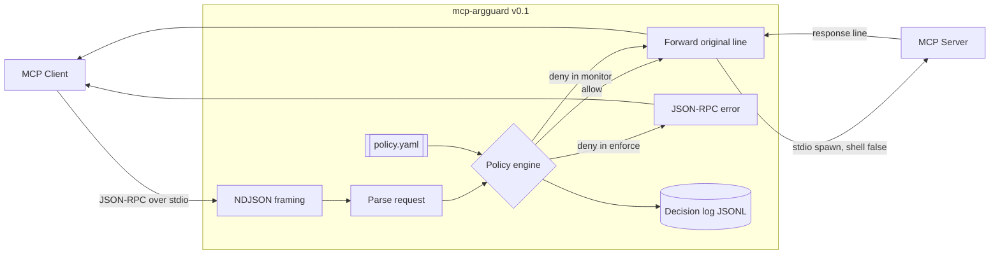

# Architecture

mcp-argguard v0.1 is a stdio process that sits between an MCP client and one MCP server. It reads newline-delimited JSON-RPC, decides whether a `tools/call` may pass, and forwards the original line when the decision is allow. Denied lines are not written to the child.

The relay is not the MCP SDK's high-level server. The SDK is used for TypeScript types, mock servers, and tests. Both the 2025-11-25 initialize handshake and stateless 2026-07-28 traffic are forwarded as JSON-RPC. The proxy records which era it observed. It does not branch the allow decision on the era.

Streamable HTTP is a stub that throws. It is planned for v0.2. The launch classifier (`src/launch/guard.ts`) is loaded in v0.1 and is not on the forward path: `wrap` warns and still starts the child. Enforcement of that classifier is v0.3.

## Decision order

For each client line:

1. Reject JSON-RPC batches. MCP does not use them (`-32600`).
2. Drop a line, or a buffer still waiting for a newline, that exceeds `limits.max_message_bytes` (`-32003` toward the client). A server line that is oversized or not JSON closes the child.
3. Non-requests (notifications and responses the client sends) are forwarded unchanged.
4. If the method is not `tools/call`, apply `methods.<name>` or `defaults.method` (default allow) and forward or deny.
5. `methods.tools/call: deny` denies every call before tool matching.
6. The `--server` profile must exist.
7. The first tool key in YAML order that matches wins. A key is exact, or a picomatch glob when it contains `*`, `?`, or `[`. No match uses `defaults.tool` (default deny).
8. A tool decision of deny stops there. Required arguments, unknown arguments, then matchers run for an allow rule. The first failing matcher denies the call.
9. `secrets` are scanned over nested strings and object keys after matchers.
10. In `enforce`, a deny is a JSON-RPC error (`-32001`) and the line is not written to the child. In `monitor`, the same decision is logged with `enforced: false` and the line is forwarded.
11. If `enforce` cannot append the decision log, the call is not forwarded (`-32004`).

`tools/call` is always logged. Other allowed methods, such as `initialize`, are not logged on every allow. Denials are logged.

## Normalization

Hostname and URL checks parse with the WHATWG URL parser, then compare the canonical host. Case, a trailing dot, and IDNA are folded before the glob. `*` and `?` do not cross a dot. IP literals are classified by a local parser, including decimal and hex IPv4 forms and IPv4-mapped IPv6. There is no DNS lookup.

Path checks resolve against the workspace, optionally walk symlinks (fail closed, hop limit 32), and then apply `within` roots and deny globs. `${workspace}` and `${home}` are expanded in policy roots, not in argument values.

## Process model

`wrap` spawns the child with `shell: false` and piped stdio. The child's stderr is copied to the proxy's stderr. The startup banner is written to stderr so it does not corrupt stdout JSON-RPC. The decision log file is created mode `0600`; its directory is `0700`.
